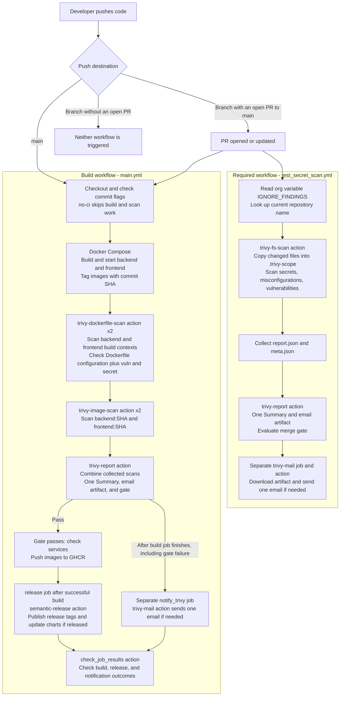

# CI and required security workflow

This diagram treats `test_secret_scan.yml` as the required security workflow.
A push to a branch with an open PR targeting `main` runs both workflows below.
A push directly to `main` runs the build workflow; the security workflow is PR-only.

- Both workflows run independently. Each has its own report and email; they do not combine reports across workflows.
- The required workflow scans only changed files, with image scanning disabled. Its `IGNORE_FINDINGS` mapping controls `ignore_finding`; a missing entry defaults to `false`.
- The build workflow explicitly uses `ignore_finding: false` and does not read `IGNORE_FINDINGS`. A required-workflow exception therefore does not bypass its build gate.
- In the updated `trivy-report` action, secrets and scan failures always fail. `ignore_finding: true` allows vulnerabilities and misconfigurations while keeping them in the report and email.
- Scans select HIGH/CRITICAL findings and exclude vulnerabilities without fixes. No findings or scan failures means a Summary with no email.
- Scan steps collect results; the report action prepares email files before evaluating the gate. Mail jobs use `always()` with `send_mail=true`, so blocking findings can still produce an email.
- `no-ci:` does not bypass the required workflow. `no-scan:` skips Trivy scan work in the build workflow. The Robot test job is currently commented out.
- The diagram assumes `test_secret_scan.yml` is required; it does not change the organization ruleset. That file currently contains no Betterleaks trailer-check job. Issue creation is not implemented.
